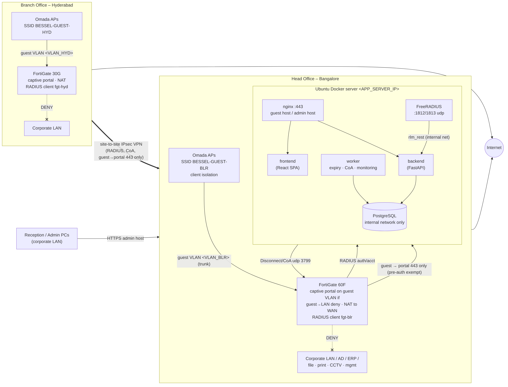
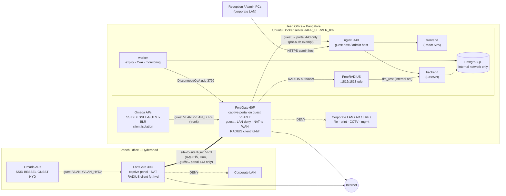
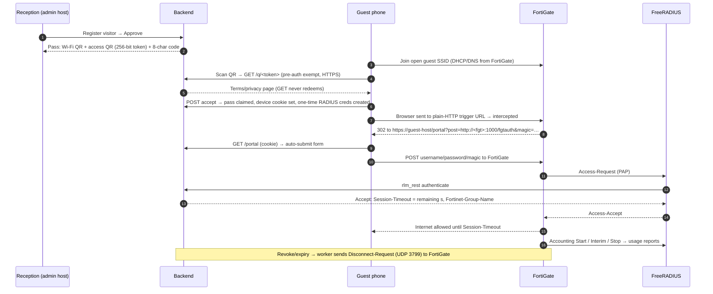

# 1. Infrastructure architecture

> Status: **design**. Device-specific values (interfaces, VLAN IDs, IPs, firmware) are placeholders written as `<LIKE_THIS>`. They will be replaced only after the Phase 1 discovery data has been reviewed (see `00-discovery-checklist.md`).

## 1.1 Overview

## 1.2 Components

| Component | Where | Role |
|---|---|---|
| Omada APs | both sites | Broadcast `BESSEL-GUEST-BLR` / `BESSEL-GUEST-HYD`, tag guest VLAN, isolate wireless clients. No change to corporate SSIDs. |
| FortiGate 60F (BLR) / 30G (HYD) | each site | Guest VLAN gateway, DHCP/DNS, **captive portal enforcement**, guest→LAN deny, NAT, shaping, session expiry from RADIUS `Session-Timeout`, accepts RADIUS Disconnect (CoA) for revocation. |
| nginx | Docker server | TLS termination. Two virtual hosts: **guest host** (only `/q/*`, `/portal*`, `/static/guest/*`) reachable from guest VLANs; **admin host** restricted to corporate subnets. `/internal/*` never published. |
| frontend | Docker | React admin / reception console (static files). |
| backend | Docker | FastAPI: RBAC, MFA, guest registration & approval, QR/code issue, guest portal pages, RADIUS decision API, reports, audit. |
| FreeRADIUS | Docker | Receives FortiGate RADIUS (PAP) and accounting; forwards every decision to the backend via `rlm_rest`. |
| worker | Docker | Expires passes, sends/retries RADIUS Disconnect-Requests, closes stale sessions, pings firewalls, applies retention. |
| PostgreSQL | Docker | System of record. On an `internal: true` Docker network: no host port, no route to guests. |

## 1.3 Authentication option evaluation (requirement §7)

| Option | Security | Maintainability | Firmware dependence | Verdict |
|---|---|---|---|---|
| **External captive portal + RADIUS** (FortiGate enforces, app decides via RADIUS) | App never holds firewall admin credentials; one-time per-guest credentials; expiry enforced by FortiGate (`Session-Timeout`) + CoA | Standard RADIUS; same design both sites | RADIUS + external portal are long-standing FortiOS features; CoA support verified per firmware in Phase 8 | **Selected** |
| FortiGate REST API (create/delete users or authorise sessions) | Needs an API token with write rights on each firewall | API paths and objects differ between firmware versions | High; 30G and 60F may run different builds | Rejected as primary; may be used read-only for monitoring later |
| FortiGate local guest accounts (guest management) | Credentials live on firewall; app must create them via API | Two places to manage users | Medium | Rejected |
| Plain RADIUS with FortiGate built-in portal (no external page) | Guest would have to type generated username/password | Poor UX, no QR | Low | Kept as **fallback** (same RADIUS backend) if external portal behaves unexpectedly on a firmware |

## 1.4 Guest connection flow

Fallback without camera: the captive popup shows the code entry page; the guest types the 8-character code, which follows the same path from step 6.

## 1.5 Security properties

- **Unpredictable, single-use passes.** QR tokens are 256-bit random, stored as SHA-256 (and Fernet-encrypted so reception can re-print). Redemption binds the pass to one browser (HttpOnly cookie) and to the first device MAC/IP seen by RADIUS. A second device gets "already used".
- **No reusable secrets on the pass.** The SSID is open (or OWE where APs support it). The per-guest RADIUS password is generated at redemption and never printed.
- **Expiry enforced by the firewall.** `Session-Timeout` is set to the remaining access time. The worker sends a RADIUS Disconnect at expiry as a backstop. Revocation is immediate via Disconnect.
- **Location binding.** A BLR pass is rejected by the HYD FortiGate (RADIUS client shortname check), and the portal refuses to post credentials to any host not configured for that site.
- **Least privilege.** The application holds no FortiGate admin credentials. Its only firewall interactions are RADIUS (FortiGate → server) and RADIUS Disconnect (server → FortiGate UDP 3799 with a shared secret).
